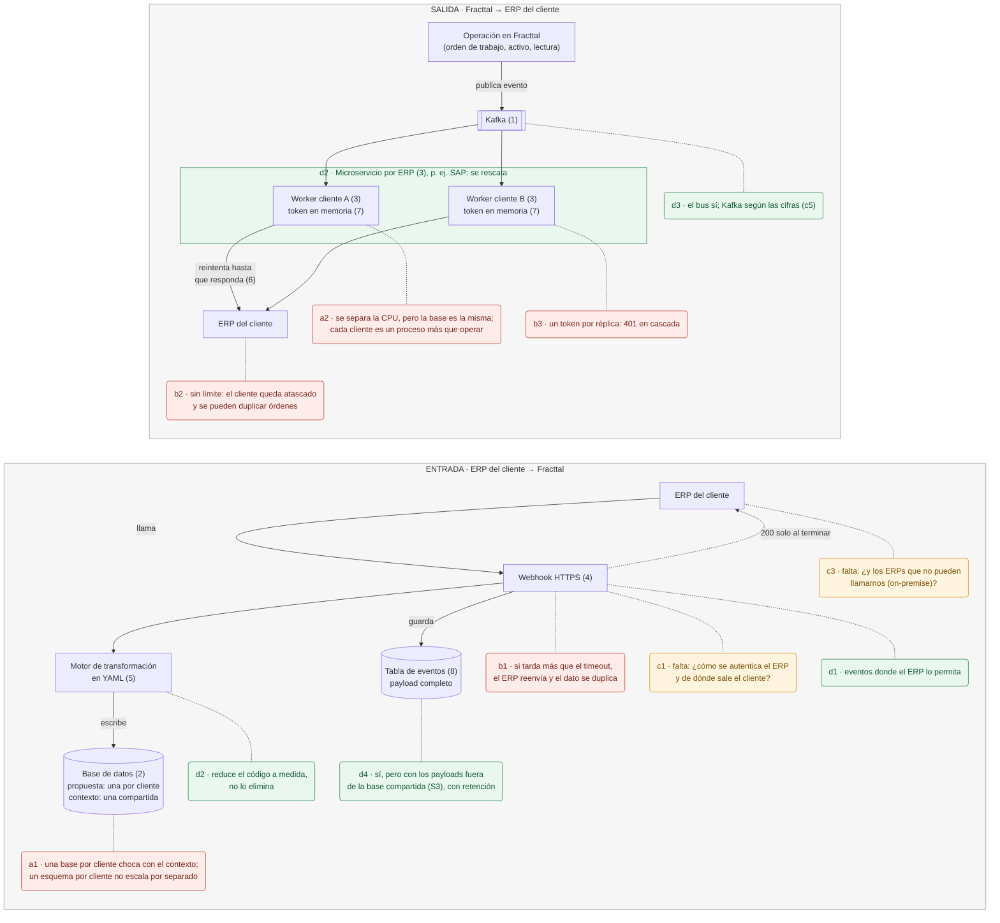

# Punto 3 · Diagrama de la revisión

La propuesta tal como está escrita, con mis comentarios marcados: no es una arquitectura alternativa.
Los números entre paréntesis son los componentes de la propuesta; los códigos (a1, b2, c1, d1...) son
los del [reporte](../REPORTE.md).

- **Rojo:** lo que no aplica o se rompe (a, b).
- **Ámbar:** lo que falta (c), cuando tiene un lugar claro. c2, c4, c5 y c6 afectan a todo el sistema y
  están solo en el reporte.
- **Verde:** lo que rescataría (d).

Las notas tienen bordes redondeados; los componentes de la propuesta son rectángulos.

Imagen exportada: [diagram.png](diagram.png).

